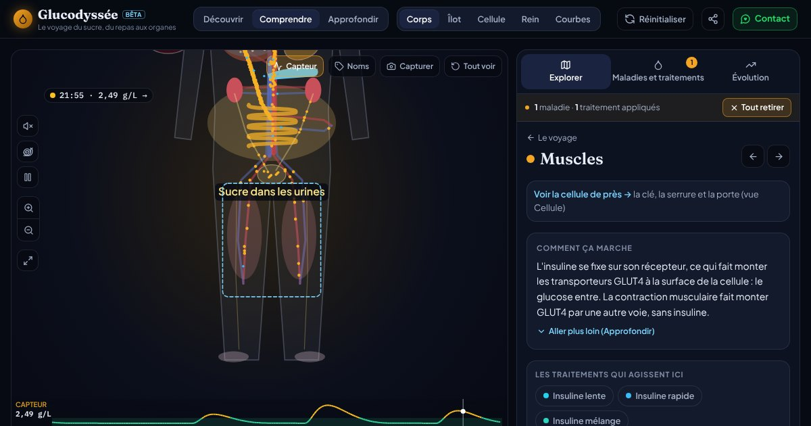

# Glucodyssée : le voyage du sucre

[](https://oumarmaiil-oss.github.io/glucodyssee/)


**Outil pédagogique gratuit et ouvert** pour comprendre et faire comprendre la glycémie, le diabète,
l'hypoglycémie, les complications et l'effet des traitements. Même base, même logique et mêmes
principes qu'[Hémodyssée](https://oumarmaiil-oss.github.io/hemodyssee/). Fonctionne sur téléphone,
tablette et ordinateur, même hors connexion.

👉 **https://oumarmaiil-oss.github.io/glucodyssee/**



## Pour qui ?
- **Étudiants** en médecine, pharmacie, dentaire, soins infirmiers ;
- **Enseignants**, **soignants** et **éducateurs thérapeutiques** ;
- **Patients et familles** (niveau « Découvrir ») ;
- **Délégués médicaux** (présentations guidées, en DCI uniquement).

## Ce qu'on peut faire
- **Explorer** : suivre le glucose d'un repas (estomac → intestin → veine porte → foie → sang → pancréas → îlot → muscles, graisse, cerveau → reins → HbA1c), régler les glucides de chaque repas.
- **5 vues** : Corps (particules de glucose et d'insuline qui suivent le moteur minute par minute), Îlot de Langerhans en 2D et en **3D**, Cellule (muscle et foie : la clé, la serrure, la porte GLUT4), Rein (néphron, SGLT2, seuil rénal), Courbes (journée de 24 h comme un capteur de glucose, avec la courbe « sans traitement »).
- **Maladies et situations** : type 1, type 2 (début, installé, évolué), prédiabète, diabète gestationnel, hypoglycémie (avec resucrage « règle des 15 »), acidocétose, repas sauté, activité physique, Ramadan, maladie rénale, rétinopathie, néphropathie, neuropathie, pied diabétique, maladie cardiovasculaire.
- **Traitements** : 9 classes (metformine, sulfamide, glibenclamide, iDPP-4, aGLP-1, iSGLT2, insuline lente, rapide, mélange 30/70), en ½, dose standard ou dose forte ; site d'action, effets indésirables, précautions (rein, Ramadan, hypoglycémie), arrêt, associations à éviter.
- **Évolution sur 10 ans** : sans traitement, traitement suivi, traitement arrêté ; perte de la fonction bêta, HbA1c, risques de complications (UKPDS 35, avec « effet mémoire »).
- **5 présentations guidées avec voix off** (voyage du sucre, type 1, type 2, hypoglycémie, Ramadan), **8 cas cliniques** corrigés, **fiche récapitulative** en PDF.
- **3 niveaux** : Découvrir, Comprendre, Approfondir. Alarmes sonores du capteur. Export photo et vidéo, partage WhatsApp.

## Contribuer
Projet **bêta** : erreurs médicales, bugs, idées, relectures et traductions sont les bienvenus.
- Dans l'application : bouton vert **Contact** (WhatsApp) ;
- Sur GitHub : [ouvrir une issue](https://github.com/oumarmaiil-oss/glucodyssee/issues/new/choose) ;
- Guide complet : [CONTRIBUTING.md](CONTRIBUTING.md).

```bash
npm install
npm run dev     # développement
npm test        # tests du moteur, du contenu et de la voix off
npm run lint    # typage
npm run build   # version publiée (déployée automatiquement sur GitHub Pages)
```

Organisation du code (identique à Hémodyssée) :
- `src/core` : moteur de glycémie calibré (`moteur.ts`, 10 tests de calibration), moteur de l'application (`engine.ts` : terrain, traitement, alertes, risques, évolution), évaluation, horloge de la journée, son, voix off ;
- `src/content` : tout le contenu sous forme de données (zones, maladies, classes, présentations, cas) ;
- `src/render` : îlot 3D (three.js, chargé à la demande), corps, îlot, cellule, rein et courbes en 2D (canvas) ;
- `src/ui` : interface React.

## Sur quoi reposent les chiffres
Moteur inspiré du modèle minimal de Bergman et du modèle de repas de Dalla Man, calibré sur des repères
cliniques (`src/core/moteur.test.ts`). HbA1c estimée : Nathan DM et al., Diabetes Care 2008 (ADAG).
Temps dans la cible : Battelino T et al., Diabetes Care 2019. Risques : UKPDS 35, Stratton IM et al., BMJ 2000.
Diagnostic, hypoglycémie, traitements : ADA, Standards of Care in Diabetes. Rein : consensus ADA/KDIGO 2022.
Ramadan : guide IDF-DAR 2021. Diabète gestationnel : IADPSG/OMS 2013. Prévention : DPP, NEJM 2002.

## Avertissement
Modèle simplifié d'un adulte type de 70 kg, à visée pédagogique : il montre les bons sens de variation
et les bons ordres de grandeur, pas l'évolution d'un patient réel. Il ne remplace ni l'avis médical ni
le RCP des médicaments, et **ne sert jamais à calculer une dose réelle**.

## Licences
- **Code** : [GNU AGPL v3](LICENSE) ;
- **Contenu pédagogique** : [CC BY-NC-SA 4.0](LICENCE-CONTENU.md).

Usage commercial, version personnalisée ou partenariat : contacter l'auteur.

## Auteur
**Dr O. Sow**, pharmacien, Dakar (Sénégal). WhatsApp : +221 77 414 47 99 · courriel : oumarmaiil@gmail.com.

---

### English
**Glucodyssée** is a free, open-source educational web app (in French) to understand blood glucose,
type 1 and type 2 diabetes, hypoglycaemia, complications and how each drug class works — with a body view,
a 3D pancreatic islet, cell and kidney views, a 24-hour CGM-style curve, guided presentations with voice-over
and clinical cases. Sister app of Hémodyssée. Built in Dakar, Senegal. Works offline on any phone.
Code: AGPL-3.0 · Content: CC BY-NC-SA 4.0.

© 2026 Dr O. Sow et contributeurs.
