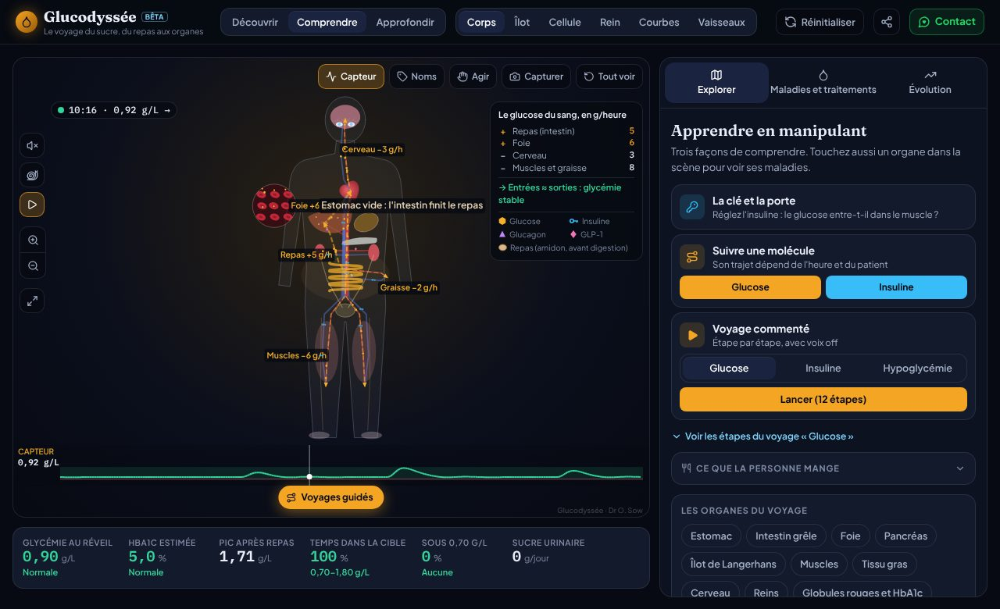
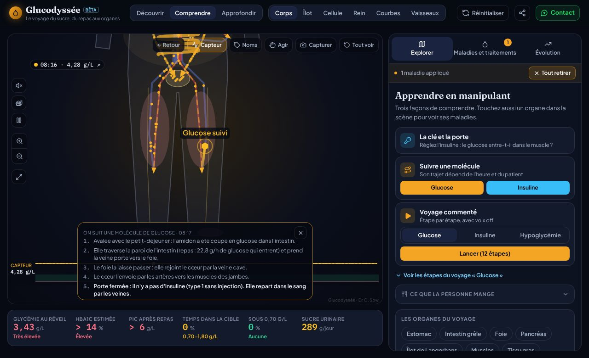
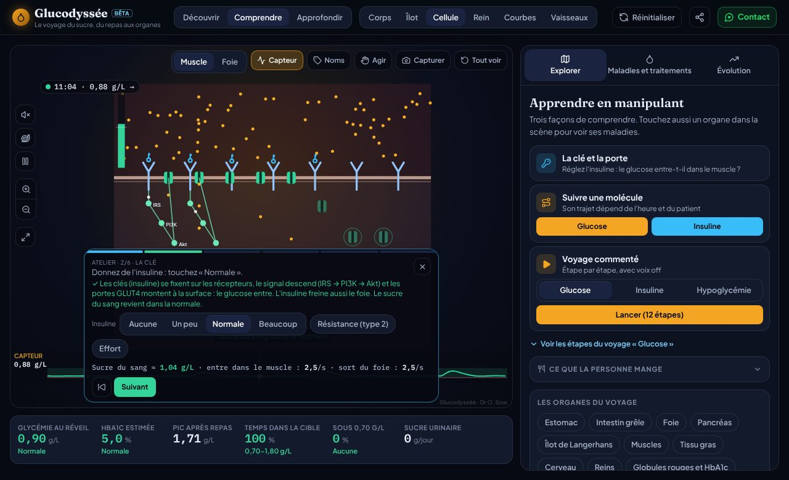
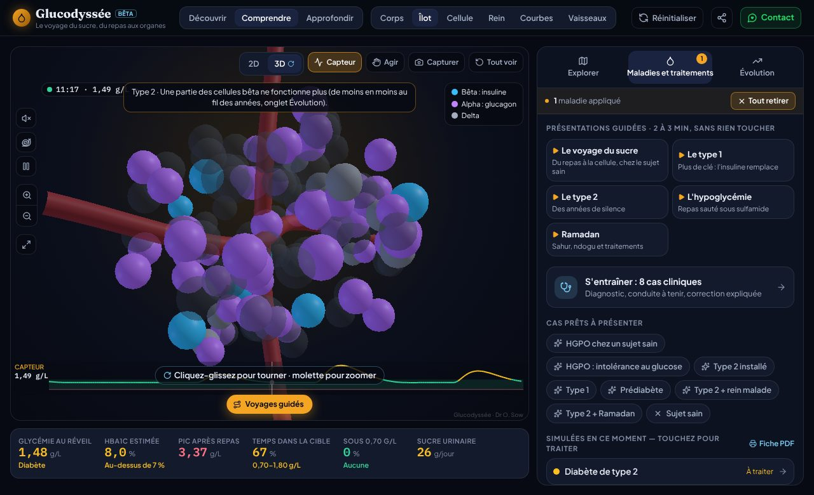
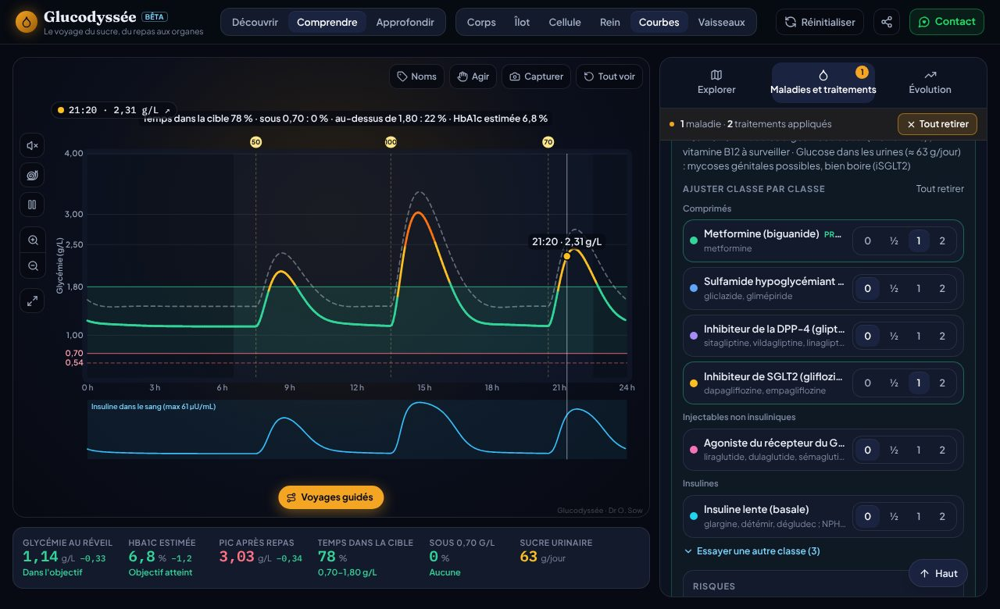
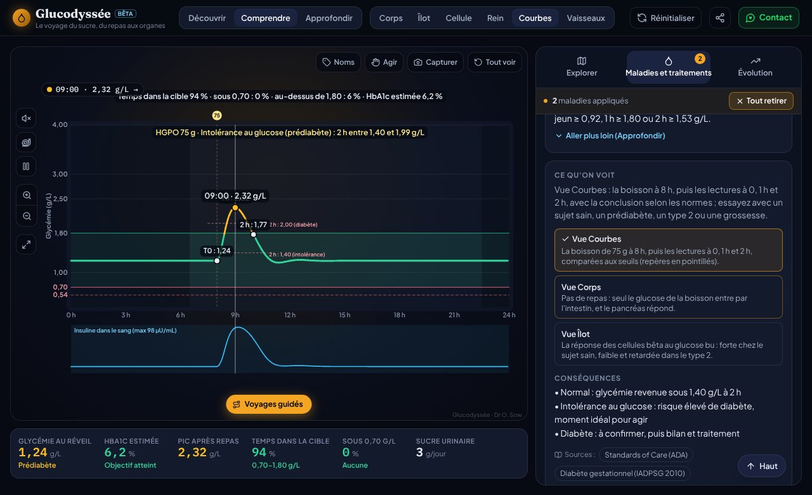
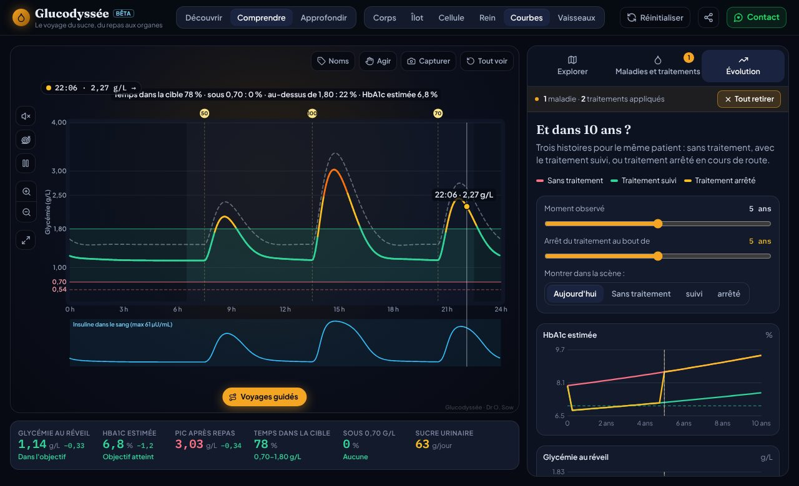
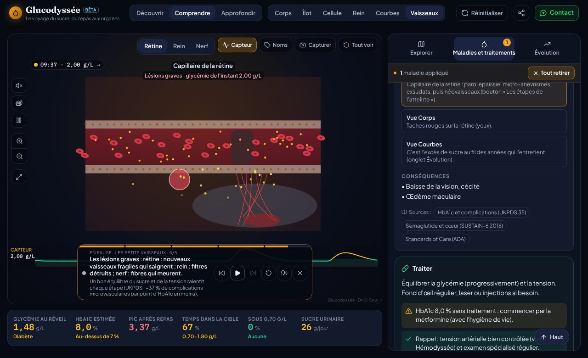
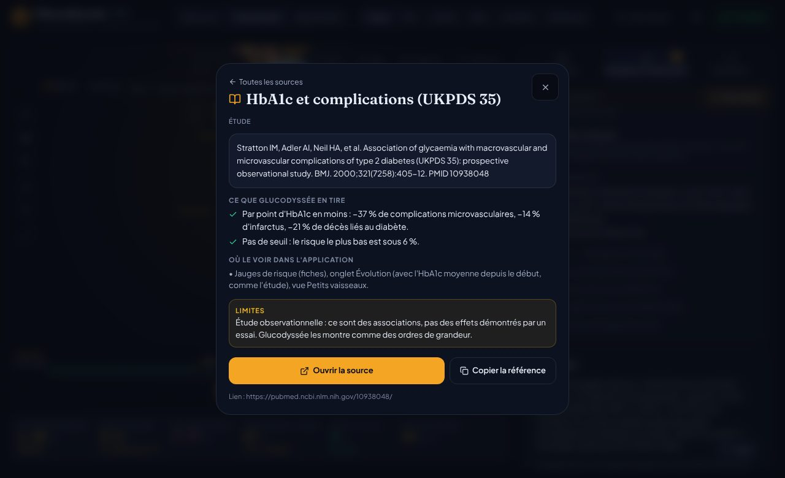
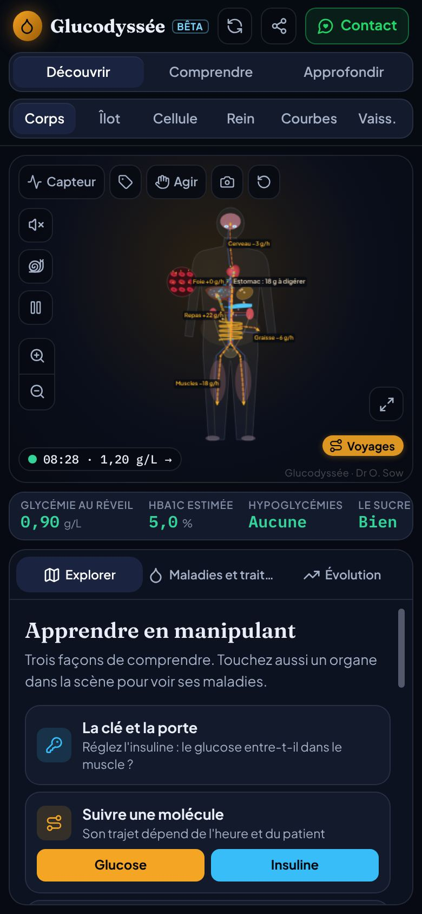

# Glucodyssée : le voyage du sucre

[](https://oumarmaiil-oss.github.io/glucodyssee/)


**Outil pédagogique gratuit et ouvert** pour comprendre et faire comprendre la glycémie, le diabète,
l'hypoglycémie, les complications et l'effet des traitements. Application sœur
d'[Hémodyssée](https://oumarmaiil-oss.github.io/hemodyssee/) : même structure, même logique.
Fonctionne sur téléphone, tablette et ordinateur, même hors connexion.

👉 **https://oumarmaiil-oss.github.io/glucodyssee/**


## Pour qui ?
- **Étudiants** en médecine, pharmacie, dentaire, soins infirmiers ;
- **Enseignants**, **soignants** et **éducateurs thérapeutiques** ;
- **Patients et familles** (niveau « Découvrir ») ;
- **Délégués médicaux** (présentations guidées, en DCI uniquement).

## Ce qu'on peut faire

| | |
|---|---|
|  | **Vue Corps : d'où vient le sucre, où il va.** Le repas entre (bouchées), l'estomac se vide, l'intestin coupe l'amidon en glucose. Flèches chiffrées en g/heure (repas, foie, cerveau, muscles, graisse, urines) et bilan « la glycémie monte / baisse ». Une forme par substance : glucose ⬢, insuline 🔑, glucagon ▲, GLP-1 ◆. |
|  | **Suivre une molécule.** La caméra suit une molécule de glucose ou d'insuline ; son trajet dépend de l'heure, du patient et du traitement (en type 1, la porte du muscle reste fermée). Un journal raconte chaque étape et sa raison. |
|  | **Atelier « La clé et la porte ».** On règle soi-même l'insuline, la résistance (type 2) et l'effort : le glucose entre-t-il dans le muscle ? 6 étapes validées par l'action de l'apprenant. |
|  | **Îlot de Langerhans en 2D et en 3D.** Cellules bêta, alpha et delta, grains d'insuline et de glucagon au rythme du moteur ; lymphocytes du type 1, cellules bêta qui s'éteignent dans le type 2, canaux K-ATP sous sulfamide. |
|  | **Courbes de 24 h** comme un capteur de glucose : bande 0,70-1,80 g/L, courbe « sans traitement » en pointillés, repas, injections, insuline. |
|  | **HGPO 75 g** : lectures à 0, 1 h et 2 h et conclusion selon les normes (ADA/OMS hors grossesse, IADPSG/OMS 2013 pendant la grossesse). |
|  | **Évolution sur 10 ans** : sans traitement, traitement suivi, traitement arrêté ; HbA1c, fonction bêta, risques de complications (UKPDS 35, avec « effet mémoire »). |
|  | **Petits vaisseaux** (rétine, rein, nerf) : glycation, paroi épaissie, fuites, occlusion, lésions graves, en démonstration pas à pas. |
|  | **Des sources vérifiables.** Sous chaque fiche, les puces « Sources » ouvrent un petit document : la référence complète, ce que l'application en tire, où on le voit, ses limites et le lien pour vérifier. Liste complète : [docs/SOURCES.md](docs/SOURCES.md). |

Et aussi :
- **17 maladies, situations et examens** : type 1, type 2, prédiabète, diabète gestationnel, HGPO, hypoglycémie (resucrage « règle des 15 »), acidocétose, repas sauté, effort, Ramadan, maladie rénale, rétinopathie, néphropathie, neuropathie, pied diabétique, maladie cardiovasculaire. Chacune dit ce qu'elle montre dans chacune des 6 vues.
- **9 classes de traitement** (metformine, sulfamide, glibenclamide, iDPP-4, aGLP-1, iSGLT2, insuline lente, rapide, mélange 30/70), en ½, dose standard ou forte, avec précautions (rein, Ramadan, hypoglycémie) et associations à éviter.
- **Agir en direct** : 15 g de sucre, collation, repas imprévu, marche ou 4 U d'insuline à l'heure affichée ; la journée se recalcule.
- **3 voyages commentés** (glucose, insuline, défense contre l'hypoglycémie), **5 présentations guidées** avec voix off, **8 cas cliniques**, **fiche PDF**.
- **Survol à la souris** : le nom et le rôle de chaque objet de la scène ; sur la courbe, l'heure et la valeur.
- **3 niveaux** (Découvrir, Comprendre, Approfondir), alarmes du capteur, capture photo et vidéo, partage WhatsApp.

<p align="center"></p>

## Contribuer
Projet **bêta** : erreurs médicales, bugs, idées, relectures et traductions sont les bienvenus.
- Dans l'application : bouton vert **Contact** (WhatsApp) ;
- Sur GitHub : [ouvrir une issue](https://github.com/oumarmaiil-oss/glucodyssee/issues/new/choose) ;
- Guide complet : [CONTRIBUTING.md](CONTRIBUTING.md).

```bash
npm install
npm run dev            # développement
npm test               # tests du moteur, du contenu, des sources et de la voix off
npm run lint           # typage
npm run build          # version publiée (déployée automatiquement sur GitHub Pages)
npm run docs:sources   # régénère docs/SOURCES.md à partir de src/content/sources.ts
```

Organisation du code (identique à Hémodyssée) :
- `src/core` : moteur de glycémie calibré (`moteur.ts`, 10 tests de calibration), moteur de l'application (`engine.ts` : terrain, traitement, alertes, risques, HGPO, évolution), évaluation, horloge de la journée, son, voix off ;
- `src/content` : tout le contenu sous forme de données (zones, maladies, classes, voyages, vues par maladie, atelier, présentations, cas, **sources**) ;
- `src/render` : îlot 3D (three.js, chargé à la demande), corps, îlot, cellule, rein, courbes et petits vaisseaux en 2D (canvas) ;
- `src/ui` : interface React.

Documents : [cahier des charges](docs/CAHIER-DES-CHARGES-GLYCEMIE.md) · [sources](docs/SOURCES.md) · [reste à faire](A_FAIRE.md) · [code de conduite](CODE_OF_CONDUCT.md).

## Sur quoi reposent les chiffres
Moteur inspiré du modèle minimal de Bergman (1979) et du modèle de repas de Dalla Man (2007), calibré sur
des repères cliniques. HbA1c estimée : ADAG (Nathan 2008). Temps dans la cible : Battelino 2019. Risques :
UKPDS 35 (Stratton 2000). Diagnostic, hypoglycémie, traitements : ADA, Standards of Care. Rein : ADA/KDIGO 2022.
Ramadan : IDF-DAR 2021. Grossesse : IADPSG 2010. Prévention : DPP 2002. Essais : LEADER, SUSTAIN-6, REWIND,
EMPA-REG OUTCOME, DAPA-HF, DAPA-CKD, CREDENCE. Détail, liens et limites de chaque source : [docs/SOURCES.md](docs/SOURCES.md).

## Avertissement
Modèle simplifié d'un adulte type de 70 kg, à visée pédagogique : il montre les bons sens de variation
et les bons ordres de grandeur, pas l'évolution d'un patient réel. L'atelier « La clé et la porte » utilise
un modèle encore plus simple (sang, muscle, foie) pour montrer les mécanismes. Il ne remplace ni l'avis
médical ni le RCP des médicaments, et **ne sert jamais à calculer une dose réelle**.

## Licences
- **Code** : [GNU AGPL v3](LICENSE) ;
- **Contenu pédagogique** : [CC BY-NC-SA 4.0](LICENCE-CONTENU.md) (attribution, pas d'usage commercial sans accord, partage dans les mêmes conditions).

Usage commercial, version personnalisée ou partenariat : contacter l'auteur.

## Auteur
**Dr O. Sow**, pharmacien, Dakar (Sénégal). WhatsApp : +221 77 414 47 99 · courriel : oumarmaiil@gmail.com.

---

### English
**Glucodyssée** is a free, open-source educational web app (in French) to understand blood glucose,
type 1 and type 2 diabetes, hypoglycaemia, the oral glucose tolerance test, complications and how each
drug class works: body view with quantified glucose fluxes, follow-a-molecule mode, an interactive
"key and door" insulin workshop, a 3D pancreatic islet, cell, kidney and small-vessel views, a 24-hour
CGM-style curve, guided tours with voice-over and clinical cases. Every figure links to a checkable source.
Sister app of Hémodyssée. Built in Dakar, Senegal. Works offline on any phone.
Code: AGPL-3.0 · Content: CC BY-NC-SA 4.0 · Contributions welcome (see [CONTRIBUTING.md](CONTRIBUTING.md)).

© 2026 Dr O. Sow et contributeurs.
