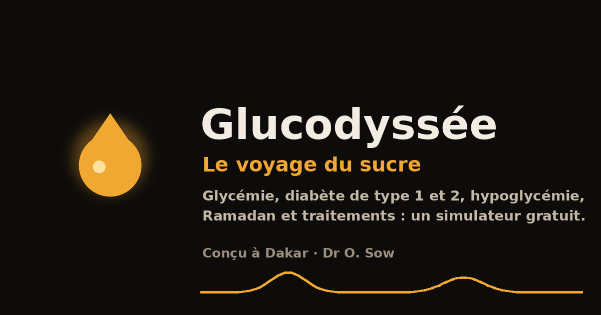

# Glucodyssée : le voyage du sucre


**Simulateur pédagogique gratuit et ouvert** pour comprendre la glycémie, le diabète de type 1 et de type 2,
l'hypoglycémie et l'effet de chaque traitement. Même famille qu'[Hémodyssée](https://oumarmaiil-oss.github.io/hemodyssee/).
Fonctionne sur téléphone, tablette et ordinateur, même hors connexion.

👉 **https://oumarmaiil-oss.github.io/glucodyssee/**



## Ce qu'on peut faire
- **Voir le sucre circuler** : points dorés (sucre) et clés bleues (insuline) dans le sang, heure par heure ; organes qui s'allument ; le site d'action de chaque traitement prend la couleur de sa classe.
- **Parcours guidé** (voix off possible) : le voyage du sucre, le diabète de type 1, le diabète de type 2, les traitements, l'hypoglycémie, Ramadan et vie réelle (42 étapes).
- **Simulateur** : choisir le patient (sain, prédiabète, type 2 à trois stades, type 1, rein malade), ses repas, ses comprimés (metformine, sulfamide, iDPP-4, aGLP-1, iSGLT2) et son insuline (lente, lente + rapides, mélange 30/70) ; courbe sur 24 heures avec la courbe « sans traitement », temps dans la cible, HbA1c estimée, sucre dans les urines, HbA1c sur 10 ans.
- **9 scénarios** : sulfamide et repas sauté, Ramadan, oubli du bolus, effort, rein malade…
- **Fiches des traitements** : où chaque classe agit, effets indésirables, précautions.

## Le moteur
`src/core/moteur.ts` : modèle physiologique simplifié, minute par minute (inspiré du modèle minimal de Bergman et
de l'absorption des repas de Dalla Man), calibré sur des repères cliniques et vérifié par 10 tests
(`npm test`). Il ne sert jamais à calculer une dose réelle.

```bash
npm install
npm run dev     # développement
npm test        # tests de calibration du moteur
npm run lint    # typage
npm run build   # version publiée (déployée automatiquement sur GitHub Pages)
```

## Contribuer
Projet **bêta** : erreurs médicales, bugs, idées et relectures sont les bienvenus (bouton vert **Contact** dans
l'application, ou une [issue](https://github.com/oumarmaiil-oss/glucodyssee/issues/new/choose)).
Cahier des charges complet : [Hémodyssée › docs/CAHIER-DES-CHARGES-GLYCEMIE.md](https://github.com/oumarmaiil-oss/hemodyssee/blob/main/docs/CAHIER-DES-CHARGES-GLYCEMIE.md).

## Licences
Code : [GNU AGPL v3](LICENSE) · contenu pédagogique : [CC BY-NC-SA 4.0](LICENCE-CONTENU.md).

## Auteur
**Dr O. Sow**, pharmacien, Dakar (Sénégal). WhatsApp : +221 77 414 47 99 · oumarmaiil@gmail.com.
